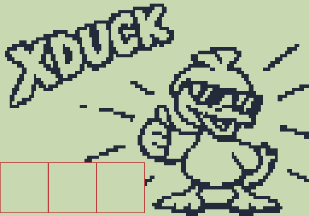

# XDuck — cross-sidechain duck / gate / texture for Zoom MS-70CDR

**Pre-release 1.13.** Duck, Gate, all routes and the key filter have been tested on a real pedal. Type = Tex has not been checked by ear yet.

Custom `.ZDL` effect for the **Zoom MS-70CDR** (firmware 2.10). It is a two-channel
sidechain processor: the level of one input controls the volume of the other.
Plug an instrument into **IN L** and a drum machine, kick or loop into **IN R**,
and the instrument pumps, gates or follows the drums.

> **MS-70CDR only.** XDuck relies on the CDR's two separate inputs (IN L / IN R).
> Other MultiStomp models have a mono input and the effect has nothing to key from.

## Install

1. Download [`release/XDuck.ZDL`](release/XDuck.ZDL) and [`release/XDuck.png`](release/XDuck.png)
   (the PNG is the Effect Manager thumbnail; keep it next to the ZDL).
2. Close Ableton Live and any browser tab that uses Web MIDI: they grab the pedal's
   MIDI port and Zoom Effect Manager stops seeing the pedal.
3. Add XDuck with Zoom Effect Manager. If an older XDuck is installed, **delete it first**:
   Effect Manager does not replace an effect with the same ID (486).
4. Put XDuck **first** in the patch so the key on IN R reaches it unprocessed.

If the pedal ever hangs: power off, hold the left knob, power on, *All Initialize*, footswitch.

## Controls (3 pages)

| Page | Knob | What it does |
|---|---|---|
| 1 | **Type** | `Duck` — key loud → target quieter (pumping). `Gate` — key loud → target opens. `Tex` — the target's volume follows the key's envelope continuously, both signals mixed to both outputs (one-band-vocoder feel). |
| 1 | **Route** | `X` — R controls L and L controls R. `R>L` — R controls L, R passes. `R<L` — L controls R, L passes. `KeyR` — R controls L, R is not heard (key only). `KeyL` — L controls R, L is not heard. |
| 1 | **Freq** | What the detector listens to: `Full`, or a band around 40, 60, 100, 150, 230, 360, 570, 880, 1.4k, 2.1k, 3.3k, 5.1k, 8k Hz (kick ≈ 60–100, snare ≈ 150–230, hats ≈ 5.1k–8k). The audio itself is not filtered. |
| 2 | **Thrsh** | Key threshold, 0…60 = 0…−60 dB. Higher number reacts to a quieter key. |
| 2 | **Range** | Maximum gain reduction, 0…60 dB (duck depth / gate floor). |
| 2 | **Ratio** | Duck: compression slope, 100 = limiter. Gate: steepness, 100 = hard gate. Tex: 100 = dB-for-dB following. |
| 3 | **Attk** | 0.1…100 ms. Duck: how fast it ducks. Gate/Tex: how fast it opens. |
| 3 | **Hold** | 0…500 ms. Holds the key level after a hit: duck stays down, gate stays open, no chatter. |
| 3 | **Rels** | 5 ms…2.5 s. Duck: recovery (the pump). Gate/Tex: how fast it closes. |

Output is always 100 % processed (no Mix). DSP cost declared: 20.

### Quick starts

- **Sidechain pump (Benassi-style):** Type `Duck`, Route `KeyR`, Freq `60`, Thrsh 40, Range 40, Ratio 80, Attk 15, Hold 10, Rels 45.
- **Trance gate from a hi-hat line:** Type `Gate`, Route `KeyR`, Freq `5.1k`, Hold 5, Rels 20.
- **Two players ducking each other:** Type `Duck`, Route `X`.

## Hardware notes found while building it

- The effect buffer (`ctx[5]`) carries the real IN L and IN R in its two 8-sample halves.
- The "raw input" buffer (`ctx[4]`) carries **only IN L** — its R half is silent — so a
  pre-chain R key does not exist. Hence "put XDuck first".
- Firmware value boxes must stay in **one horizontal row** (all ~820 stock ZDLs do this);
  a vertical column drew a stray bar on the screen.
- Parameter names longer than 5 characters overlap on the pedal display.

## Building from source

XDuck is built with the toolchain of
[themanro/ZoomMultistompZDL](https://github.com/themanro/ZoomMultistompZDL)
(a fork of [repeat98/ZoomMultistompZDL](https://github.com/repeat98/ZoomMultistompZDL))
and the TI C6000 compiler 8.5.0.LTS (ships with Code Composer Studio).

1. Clone the themanro fork and copy `src/xduck/` to `src/custom/xduck/`.
2. Copy the files from `toolchain-patches/` over the same paths in the fork. They add:
   - `build/selector_metadata.py` — the on-pedal words for Type / Route / Freq;
   - `build/parameter_display.py` — the 5-letter pedal names Thrsh / Attk / Rels;
   - `src/airwindows/common/pack_covers.py` and `custom_covers.py` — the XDuck screen
     (`draw_xduck`, `XDUCK_KNOBS`) and an optional `version` argument for covers.
3. In `src/custom/xduck/build.py` set `TI_ROOT` to your compiler and `out_dir` to where
   you want the ZDL, then run `python src/custom/xduck/build.py`.

The DSP (`xduck.c`) follows the fork's safe-DSP rules: no switch / jump tables, no math
library, no divides (log2/exp2 by bit tricks, Newton reciprocal), no static arrays,
state in the `ctx[3]` arena, `ctx[11]`/`ctx[12]` shuttle preserved. The `.audio` section
has no calls and returns through `B3` only (checked with `dis6x`).

The screen art (`xduck_art.json`) is a 1-bit conversion of a reference picture drawn
for this effect; see the `source` field in that file for how it was made.

## History

See [CHANGELOG.md](CHANGELOG.md).

## License

MIT, same as the toolchain it is built on — see [LICENSE](LICENSE).
